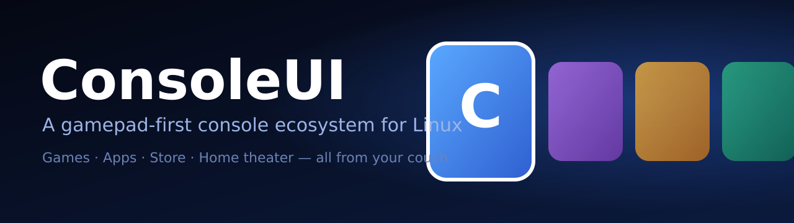
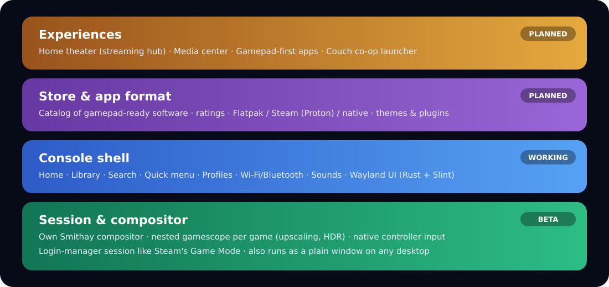
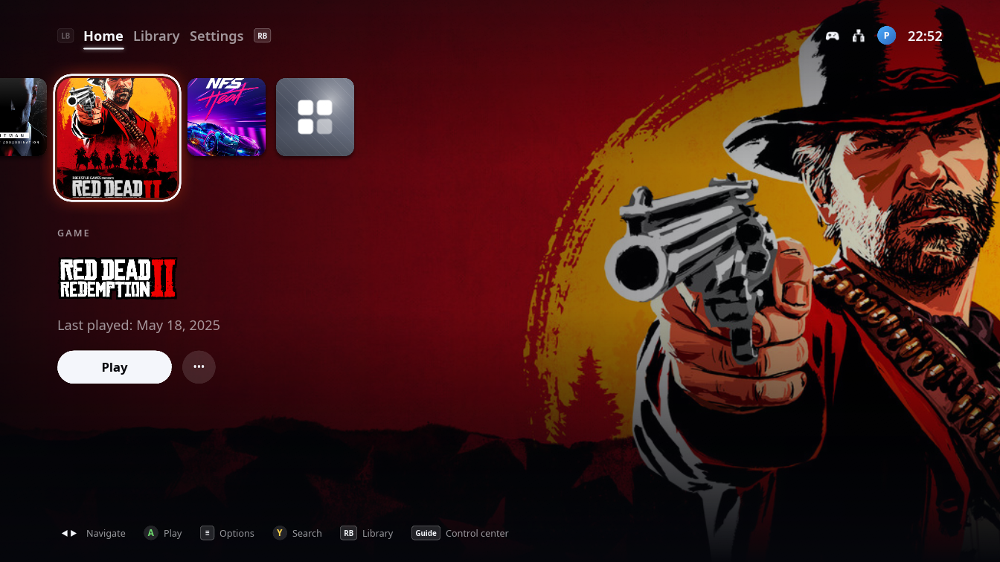
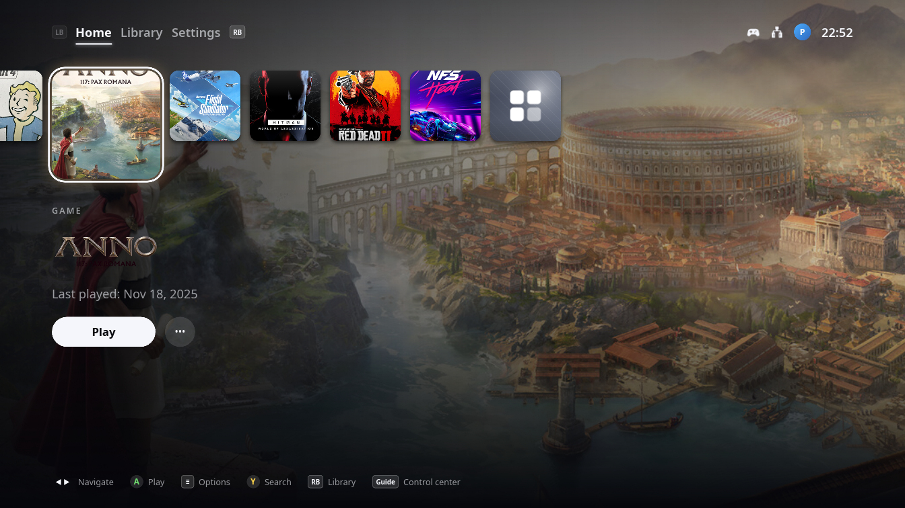
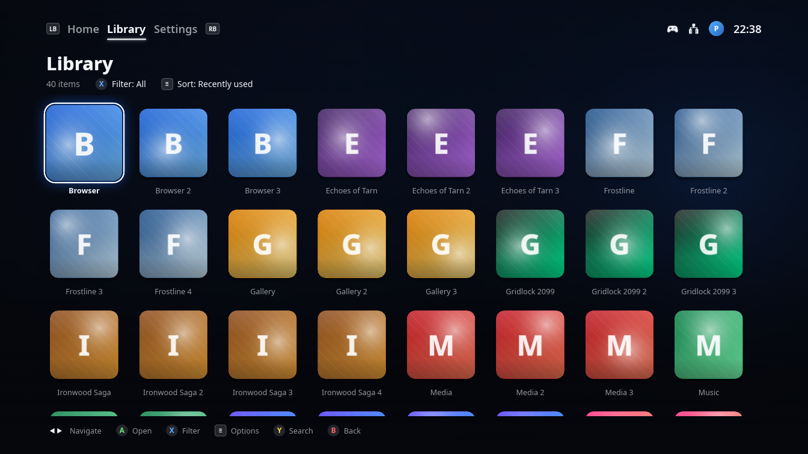
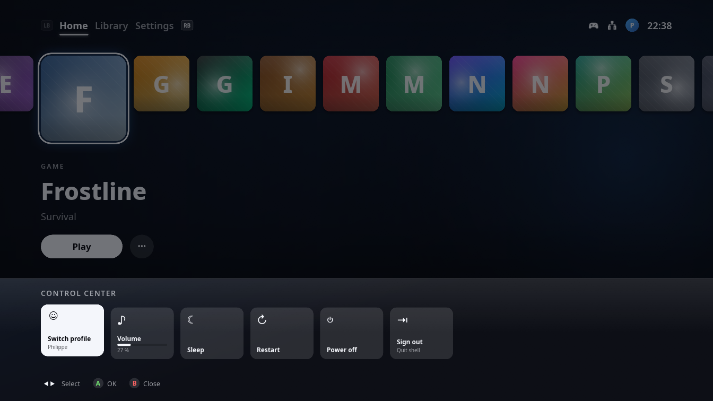
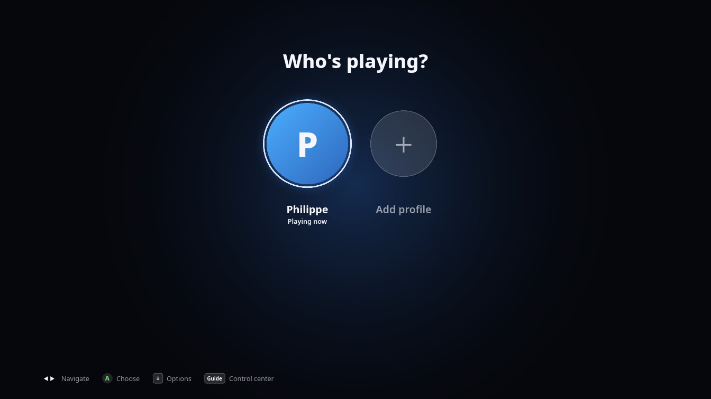
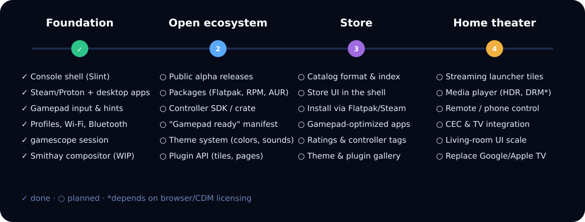

<div align="center">



<br>

[](https://github.com/Two-Play/ConsoleUI/actions)
[](LICENSE)
[](https://www.rust-lang.org)
[](https://slint.dev)
[](https://github.com/Smithay/smithay)
[](#-status)
[](CONTRIBUTING.md)
[](https://github.com/Two-Play/ConsoleUI/labels/good%20first%20issue)

**Your Linux PC, as a console. Controller in hand, couch under you.**

[Vision](#-vision) · [Screenshots](#-screenshots) · [Features](#-features) · [Roadmap](#-roadmap) · [Getting started](#-getting-started) · [Contributing](#-contributing)

</div>

---

## 🎯 Vision

Thanks to Proton, thousands of Windows games now run well on Linux, and the hardware is more
than capable. What is missing is a *console experience*: you still need a mouse and keyboard to
pick a game, join Wi-Fi, switch a profile or find software that works with a controller.

**ConsoleUI is building that missing layer, as an open ecosystem:**

| | |
|---|---|
| 🎮 **Native controller support** | Everything is operated with a gamepad: home, library, search, Wi-Fi, Bluetooth, profiles, on-screen keyboard. No mouse needed, ever. |
| 🐧 **Proton-ready** | Linux has few native games, but Steam's Proton runs thousands of Windows titles. ConsoleUI treats them as first-class: your Steam library, covers and launching just work. |
| 🛒 **A store for gamepad software** | A catalog where you find games *and apps* that are known to work with a controller, with honest "gamepad ready" ratings. |
| 🧩 **Gamepad-optimized apps** | A design language, an input SDK and a manifest format so apps can look and feel like they belong on a console. |
| 🎨 **Themes and plugins** | Make it yours: community themes (colors, backgrounds, sounds, layouts) and plugins that add new tiles, pages and services. |
| 📺 **Home theater, later** | Control and watch your streaming services from the couch, so you don't need a Google TV or Apple TV box. Your PC *is* the box. |
| 🔓 **Open and hackable** | GPL-3.0, written in Rust, no vendor lock-in, runs as a full session or just a window on your current desktop. |

<div align="center">

</div>

## 📸 Screenshots

<div align="center">

<br><sub><b>Home</b>: your Steam games (Windows titles run through Proton) with their own artwork as background, and hints for your controller.</sub>
</div>

<br>

<table>
  <tr>
    <td width="50%"><br><sub><b>Every game sets the mood</b>: crossfading hero art, logo and parallax.</sub></td>
    <td width="50%"><br><sub><b>Library</b>: grid with filter, sort and search.</sub></td>
  </tr>
  <tr>
    <td width="50%"><br><sub><b>Control center</b>: opens over a running game with the Guide button.</sub></td>
    <td width="50%"><br><sub><b>Profiles</b>: "Who's playing?", each with its own history and settings.</sub></td>
  </tr>
</table>

<sub>Game artwork belongs to its respective owners and is shown for illustration. The Library, Control center and Profiles shots use `--dummy` placeholder entries.</sub>

## ✨ Features

**Working today**

- 🏠 Home screen with a tile row, hero background crossfades, parallax and launch animations
- 📚 Library of **Steam games** and **desktop apps** (`.desktop`, Flatpak), cover art from Steam's cache
- 🔎 Search with an on-screen keyboard, pinning and hiding of entries
- 🎛️ Gamepad input via `gilrs` with hold-to-repeat, button glyphs that match Xbox, PlayStation or keyboard
- 🧭 Control center over running games (exclusive controller grab so the game gets no stray input)
- 📶 Wi-Fi and Bluetooth pages (NetworkManager / BlueZ), volume, suspend, reboot, power off
- 👥 Profiles ("Who's playing?") with separate history, collection and settings
- 🔊 Synthesized UI sounds and an ambient background loop
- 🌍 English and German, translation catalog in `lang/`
- 🪟 Runs in a window, in nested/real **gamescope**, or on our own **Smithay compositor**
- 🪄 Per-game nested gamescope options: resolution, upscaler (FSR/NIS), FPS limit, HDR

**In progress:** own compositor (`crates/compositor`) with animated app transitions and backdrop blur, DRM session on real hardware.

## 🗺️ Roadmap

<div align="center">

</div>

| Phase | Goal | Highlights |
|---|---|---|
| ✅ **1. Foundation** | A console shell you can live in | Home, library, search, profiles, settings, gamescope + own compositor |
| 🚧 **2. Open ecosystem** | Make it installable and extensible | Alpha releases, Flatpak/RPM/AUR packages, controller input SDK, "gamepad ready" manifest, **theme system, plugin API**, contributor docs |
| 🔜 **3. Store** | Find software that works with a controller | Catalog format and index, store pages in the shell, install through Flatpak/Steam, controller tags and ratings, **theme and plugin gallery**, updates |
| 🔭 **4. Home theater** | Replace the streaming box | Streaming launcher tiles, media player, phone remote, HDMI-CEC, living-room scaling |

The detailed backlog with epics and story IDs lives in [`BACKLOG.md`](BACKLOG.md). Pick anything
marked as open and say hello in an issue first.

> **A note on streaming:** services such as Netflix or Disney+ use DRM (Widevine) that depends on
> the browser. The home theater phase starts with launching them as controller-friendly web apps and
> remote control, then looks at deeper integration. Patches and ideas are very welcome.

## 🚀 Getting started

**Requirements:** Linux, a recent Rust toolchain ([rustup](https://rustup.rs)), a gamepad is optional
(keyboard works: arrows, Enter, Esc, Tab).

```bash
git clone https://github.com/Two-Play/ConsoleUI.git
cd ConsoleUI
cargo run --release -- --windowed --dummy      # try it with made-up entries
cargo run --release -- --windowed              # use your real Steam and desktop library
```

Quit with `Ctrl+Q`. Handy flags: `--fps` (overlay), `--profile <name>`, `--start library|search|settings|profiles`.

<details>
<summary><b>Run as a console session (gamescope or own compositor)</b></summary>

```bash
session/consoleui-nested                 # simulate the console session in a desktop window
session/consoleui-nested --compositor    # same, on our own compositor
sudo session/install.sh                  # install a login-manager session (after cargo build --release)
```

See [`docs/spike-gamescope.md`](docs/spike-gamescope.md) and [`docs/spike-smithay.md`](docs/spike-smithay.md).
</details>

<details>
<summary><b>Development container and test VM</b></summary>

The compositor needs `-devel` packages. A Fedora toolbox holds them all:

```bash
dev/toolbox.sh create
dev/toolbox.sh run cargo test --workspace
```

The DRM backend is tested in a VM, never on your host display: see [`docs/dev-vm.md`](docs/dev-vm.md).
</details>

## 🧱 Architecture

```
crates/core         UI-free logic: library discovery, input, profiles, settings, i18n (unit tested)
crates/shell        The Slint UI and glue (binary: consoleui)
crates/compositor   Smithay session compositor (binary: consoleui-compositor)
session/            Login-manager session files and scripts
lang/               Translation catalogs (gettext .po)
docs/               Design notes, spikes, dev VM
```

The shell is independent of the compositor and only talks to it over a small JSON control socket,
so it also runs on gamescope or as a plain window. See [`CLAUDE.md`](CLAUDE.md) for a detailed
tour of the code (it doubles as an architecture guide for human contributors too).

## 🤝 Contributing

ConsoleUI is built in the open and **we want your help**, whether you write Rust, design UI,
translate, test hardware or just have opinions about couch ergonomics.

- 🐛 Found a bug or have a controller that misbehaves? [Open an issue](https://github.com/Two-Play/ConsoleUI/issues/new/choose)
- 💡 Have an idea for the store or the home theater? Start a [discussion](https://github.com/Two-Play/ConsoleUI/discussions)
- 🌍 Translate the UI: add a `.po` file under `lang/`
- 🛠️ Hack on code: read [`CONTRIBUTING.md`](CONTRIBUTING.md), pick a [good first issue](https://github.com/Two-Play/ConsoleUI/labels/good%20first%20issue)
- 🎮 Test on your hardware: PS4/PS5/Xbox/8BitDo/Steam Deck, NVIDIA/AMD/Intel, handhelds

Please follow our [Code of Conduct](CODE_OF_CONDUCT.md). Security issues: see [`SECURITY.md`](SECURITY.md).

## Acknowledgements

Built on [Slint](https://slint.dev), [Smithay](https://github.com/Smithay/smithay),
[gilrs](https://gitlab.com/gilrs-project/gilrs) and [gamescope](https://github.com/ValveSoftware/gamescope).
Inspired by the Steam Deck's Game Mode and the PS5/Xbox dashboards. ConsoleUI is an independent
project and is not affiliated with Valve, Sony or Microsoft; all trademarks belong to their owners.

## 📄 License

[GPL-3.0-or-later](LICENSE). Contributions are accepted under the same license.
